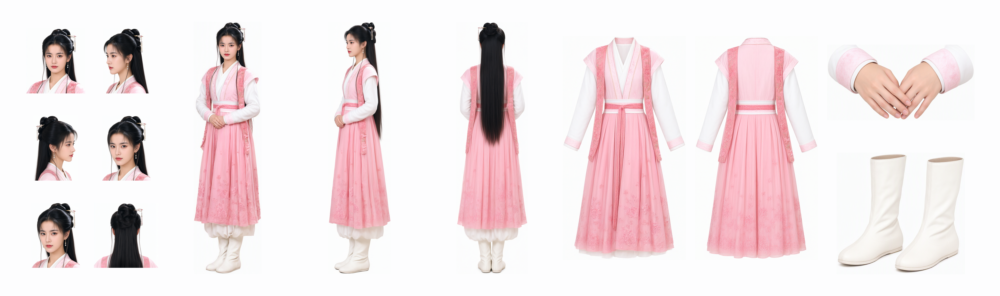
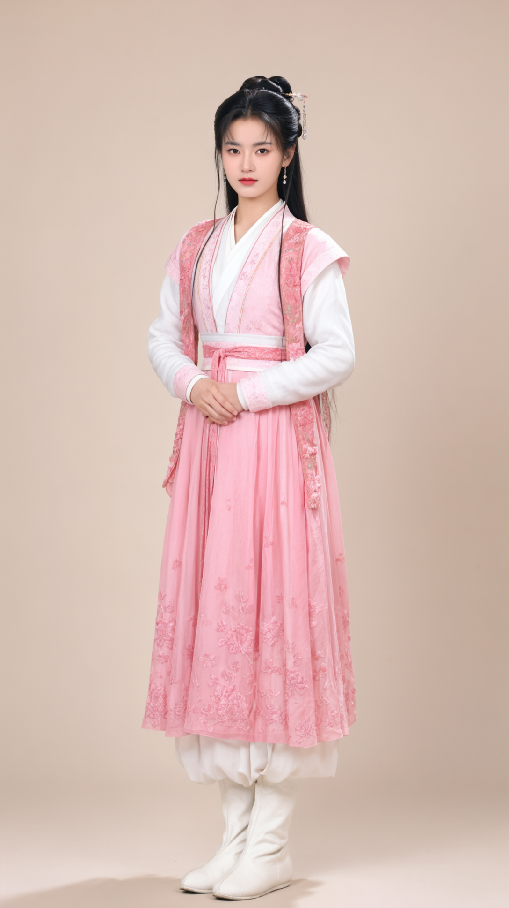
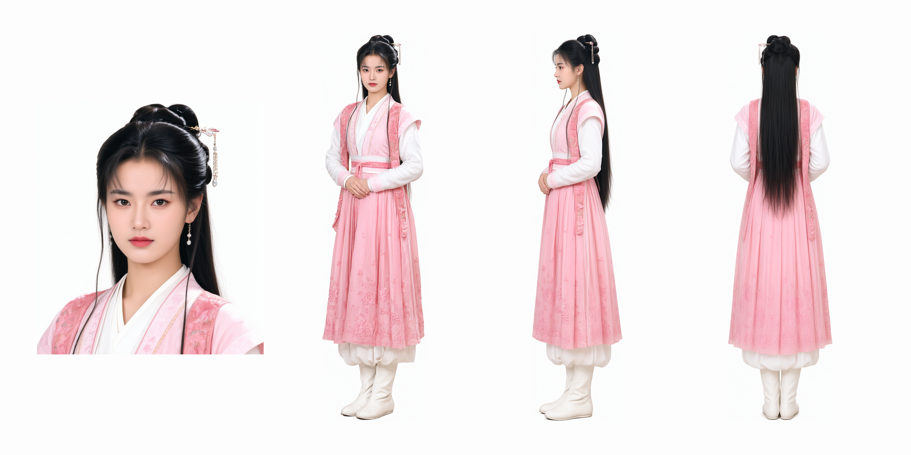
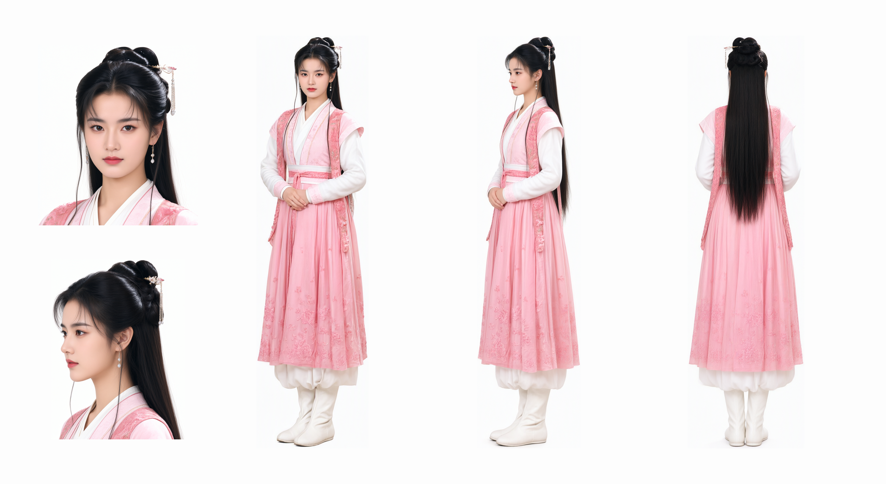
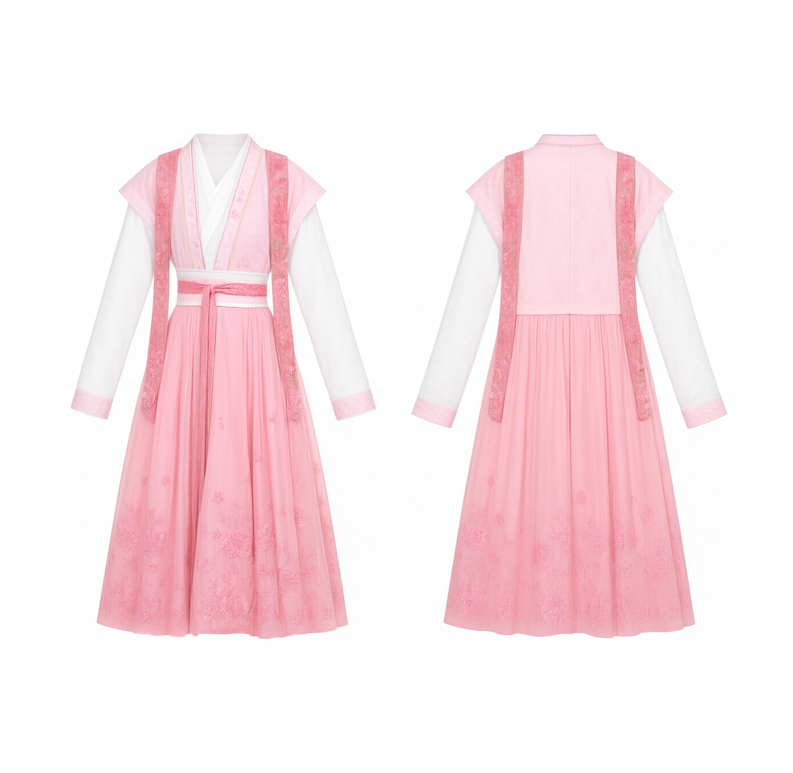
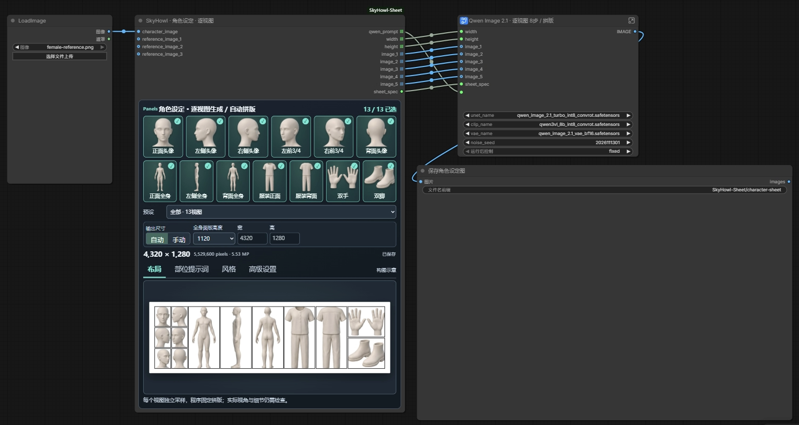
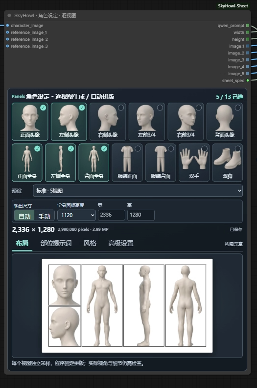

# ComfyUI SkyHowl Sheet

**Turn one reference image into an organized set of character views and costume details.**

English · [简体中文](README.md) · Initial release **v0.1.0**

SkyHowl Sheet is a ComfyUI character-reference plugin. Choose head, full-body, garment, hand and footwear views in one visual panel. Qwen Image 2.1 generates each view separately, then the plugin assembles them into a reference sheet for animation, AI comics and film pre-production.

## Example results

*Six head angles, three full-body angles, front/back garments, hands and footwear. These images are actual tests of the same female character. They demonstrate output formats, not guaranteed results for every reference or seed.*

### Input reference

### Character sheets

**Four views: front portrait and front, side and rear full-body views.**

**Five views: front/profile portraits and three full-body angles.**

### Front and back garments

## Features

- **Choose the views you need:** 13 view/detail options, presets and custom combinations.
- **Refine specific parts:** part prompts and scoped additional references.
- **Automatic composition:** rectangular outer-margin trimming and proportional scaling with shared group heights. No stretching, matting or source-background replacement.
- **Canvas color matching:** generation requests white backgrounds; reliable near-white edges determine the canvas color without changing source pixels.
- **Keep control:** model, size, style and seed controls, with dedicated rear-hair, garment and footwear instructions.

## Workflow and panel

*Screenshots illustrate operation; they do not verify the final subgraph wiring or automatic node heights.*

## Installation and use

1. Place the plugin at `ComfyUI/custom_nodes/ComfyUI-SkyHowl-Sheet`.
2. Run `python -m pip install numpy Pillow` using ComfyUI's Python.
3. Install compatible Qwen Image 2.1 models and the required nodes. See [dependencies](docs/DEPENDENCIES.md). Weights are not included.
4. Restart ComfyUI, refresh the browser and import the [UI workflow](workflows/SkyHowl-Sheet.json).
5. Select `examples/reference.png` or your own reference in Load Image, choose views and installed models, then run.

The [API workflow](workflows/SkyHowl-Sheet.api.json) is for API submission, not UI import. `female-reference.png` in the template is a placeholder; select a real image before running.

**N selected views require N independent sampling passes, followed by CPU composition.** This is not a one-pass sheet generator. Start with one view before a complete sheet. The current per-view composer does not require an additional OpenCV installation.

## Limitations

Generated orientation, hairstyle, rear garment structure, hands and identity still require inspection. Group alignment uses image bounds rather than anatomical landmarks. Source shadows, gradients and differences between generated backgrounds remain intact; a flat canvas color cannot remove every seam.

[Troubleshooting](docs/TROUBLESHOOTING.md) · [Changelog](CHANGELOG.md)

## Credits and licensing

This project incorporates and adapts portions of the semantic compiler and UI logic from [H3 Character Sheet Designer](https://github.com/ukr8b3g-cmyk/H3-Character-Sheet-Designer) by ukr8b3g-cmyk, and references its view-selection and layout design. Thank you for the open-source contribution. The recorded source revision is `abdd8c570d7b08c61dec84cc2f054f8255e2ff6b`, not the latest upstream release.

SkyHowl Sheet adds Qwen Image 2.1 per-view sampling and automatic composition. Code is licensed under **MIT**, retaining upstream copyright and license notices. See [LICENSE](LICENSE), [UPSTREAM-LICENSE](UPSTREAM-LICENSE) and [UPSTREAM-NOTICE.md](UPSTREAM-NOTICE.md). Attribution does not imply endorsement or grant rights to upstream artwork or models. Example-image scope is documented in [examples/README.md](examples/README.md).
