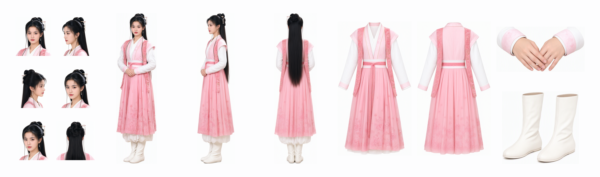
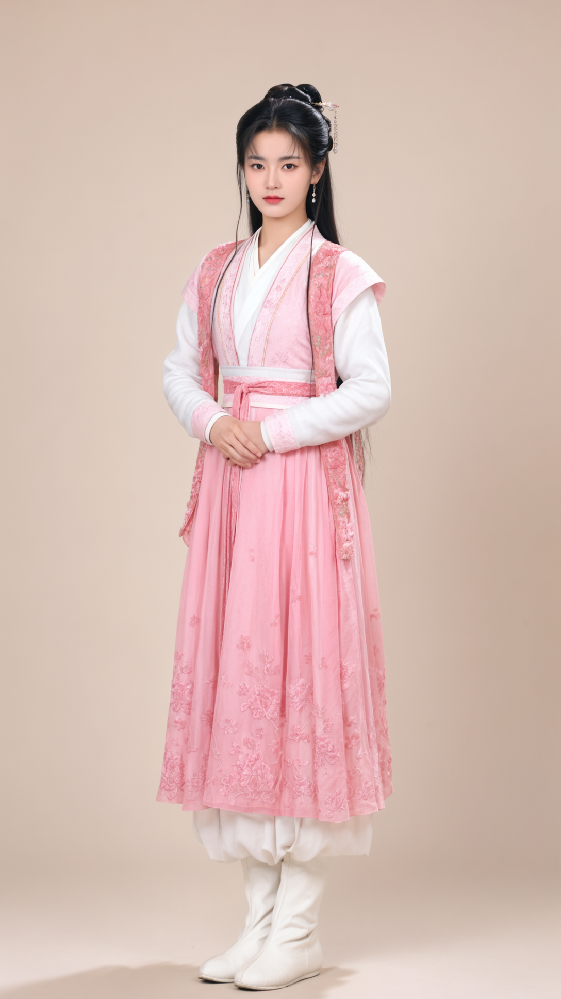
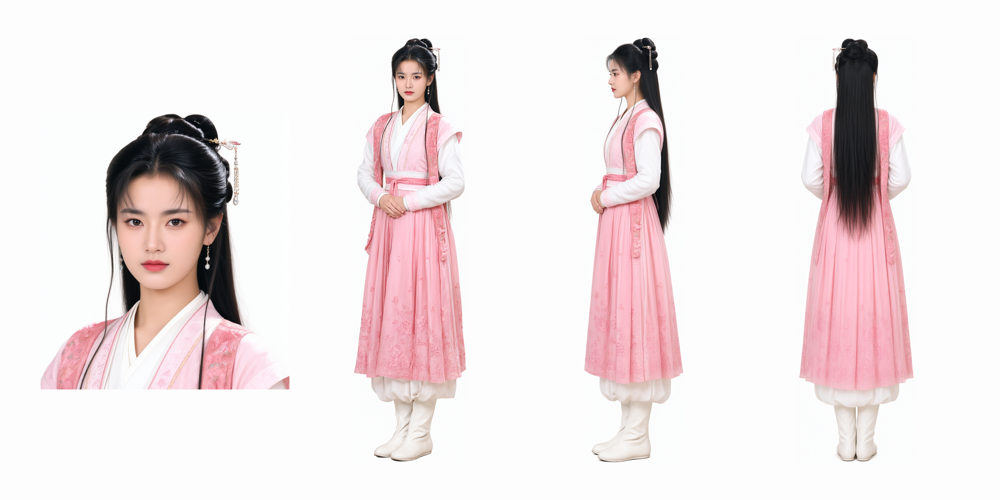
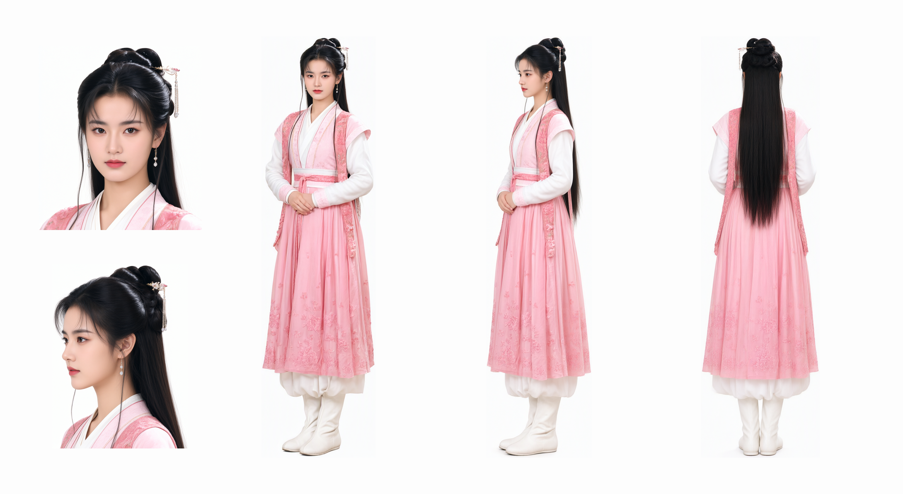
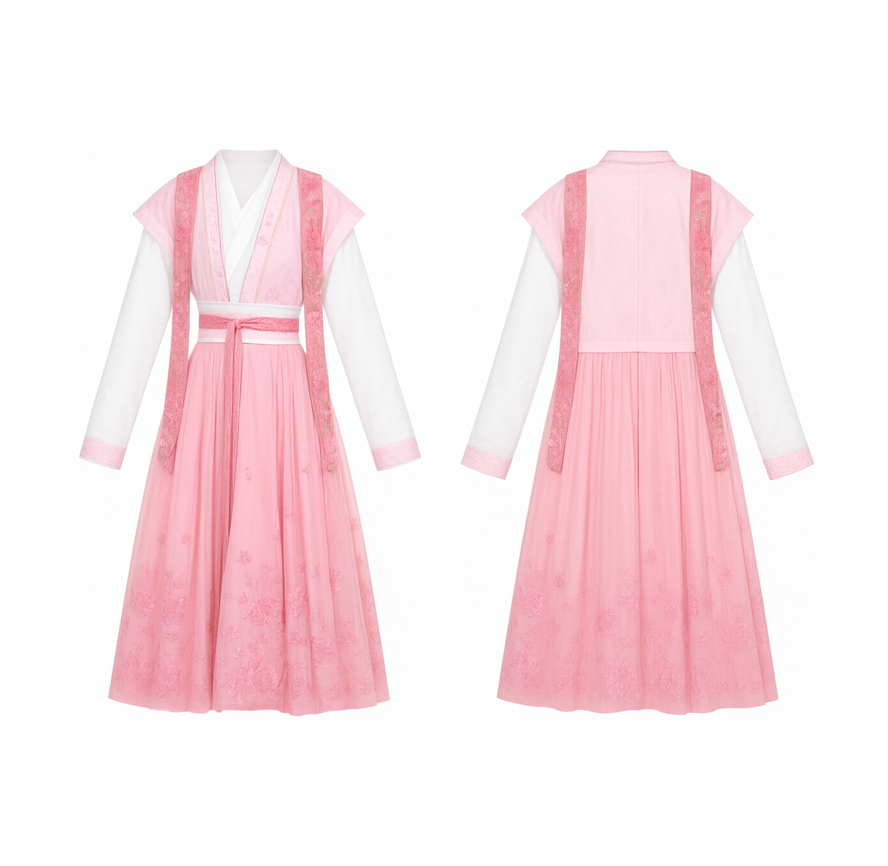
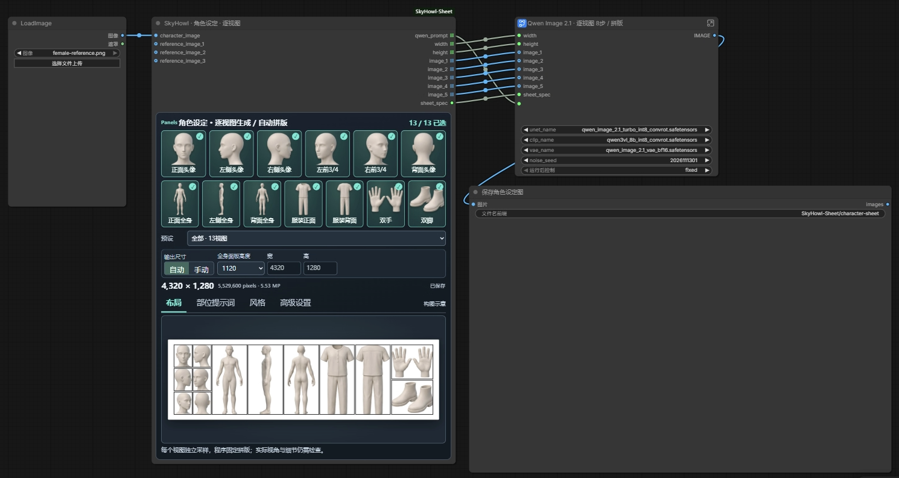
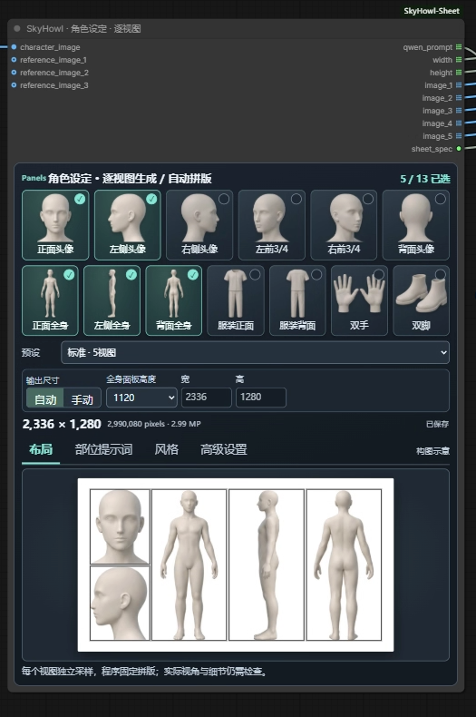

# ComfyUI SkyHowl Sheet

**从一张参考图，整理角色的多角度外观与服装细节。**

[English](README.en.md) · 首发版本 **v0.1.0**

SkyHowl Sheet 是一个面向 ComfyUI 的角色设定图插件。它将头像、全身、服装正背面、双手和鞋靴集中到一个选择面板中，使用 Qwen Image 2.1 逐视图生成，再自动排列成一张角色参考图。适合 AI 漫剧、动画和影视前期的角色外观整理。

## 效果展示

*十三视图示例：六个头像角度、三个全身角度、服装正背面、双手及鞋靴。以下图片来自同一女性角色的实际测试，用于说明输出形式，不保证所有参考和种子得到相同效果。*

### 输入参考

### 常用角色设定

**四视图：正面头像＋全身正面、侧面、背面。**

**五视图：正面与侧面头像＋三个全身角度。**

### 服装正背面

## 能做什么

- **按需选择视图**：13个视角/细节选项，包含六头像、全身三视图、服装、手脚等常用预设，也可自由组合。
- **局部调整**：填写相关部位提示词，分配额外参考图的作用范围。
- **自动拼版**：矩形裁除外部空边，等比缩放，按组统一显示高度；不拉伸人物，不抠像、不替换原图背景。
- **背景衔接**：生成提示词要求白背景，画布从各图可信近白边缘采样底色；只调整画布，不修改原图像素。
- **保留控制**：可选择模型、尺寸、风格和种子；后视发型、空衣及独立鞋靴有专门提示词约束。

## 工作流与面板

*工作流截图说明操作结构，不作为最终子图布线和节点高度的验收证据。*

## 安装与使用

1. 将插件目录放入 `ComfyUI/custom_nodes/ComfyUI-SkyHowl-Sheet`。
2. 用运行 ComfyUI 的 Python 安装依赖：`python -m pip install numpy Pillow`。
3. 准备兼容的 Qwen Image 2.1 模型和工作流所需节点，具体见 [依赖清单](docs/DEPENDENCIES.md)。模型不包含在包内。
4. 重启 ComfyUI、刷新浏览器，导入 [UI工作流](workflows/SkyHowl-Sheet.json)。
5. 在加载图像节点选择 `examples/reference.png` 或自己的角色参考图，选择视图和模型后运行。

[API工作流](workflows/SkyHowl-Sheet.api.json)用于API提交，不能代替UI工作流导入。示例工作流的 `female-reference.png` 是占位名，使用前必须重新选择实际图像。

**选 N 个视图，就进行 N 次独立采样，最后由 CPU 拼版。** 不是一次生成整张设定图。建议先验证单个视图，再运行完整设定图；当前逐视图拼版不需要额外安装 OpenCV。

## 使用边界

生成模型可能画错视角、发型、服装背面或手脚细节；角色身份和局部结构仍需检查。同组齐高依据图像边界，不等于人体关键点精确对齐。生成阴影、渐变和各视图底色差异会保留，单色画布无法完全消除接缝。

[排障说明](docs/TROUBLESHOOTING.md) · [更新日志](CHANGELOG.md)

## 致谢与许可

本项目基于并改编了 [H3 Character Sheet Designer](https://github.com/ukr8b3g-cmyk/H3-Character-Sheet-Designer)（ukr8b3g-cmyk）的部分语义编译与界面逻辑，并参考其多视角选择及布局设计。感谢原作者的开源贡献。记录的来源提交为 `abdd8c570d7b08c61dec84cc2f054f8255e2ff6b`，不代表合并了上游最新版本。

SkyHowl Sheet 针对 Qwen Image 2.1 增加逐视图采样与自动拼版适配。代码采用 **MIT**，保留上游版权及许可证；详见 [LICENSE](LICENSE)、[UPSTREAM-LICENSE](UPSTREAM-LICENSE) 和 [UPSTREAM-NOTICE.md](UPSTREAM-NOTICE.md)。这不代表上游作者背书，也不授予上游图片、模型等资源的使用权。示例图片的范围见 [examples/README.md](examples/README.md)。
